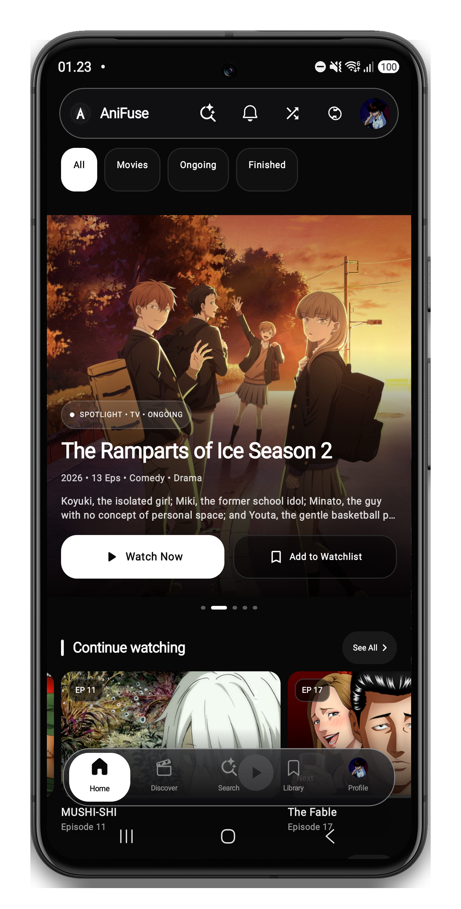
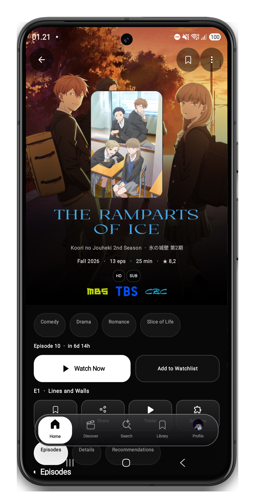
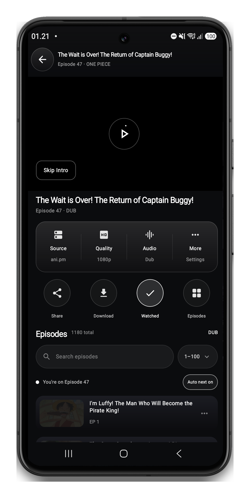
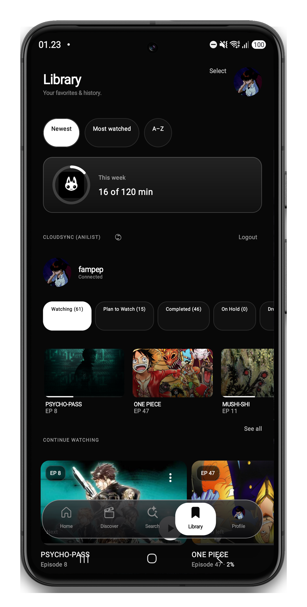
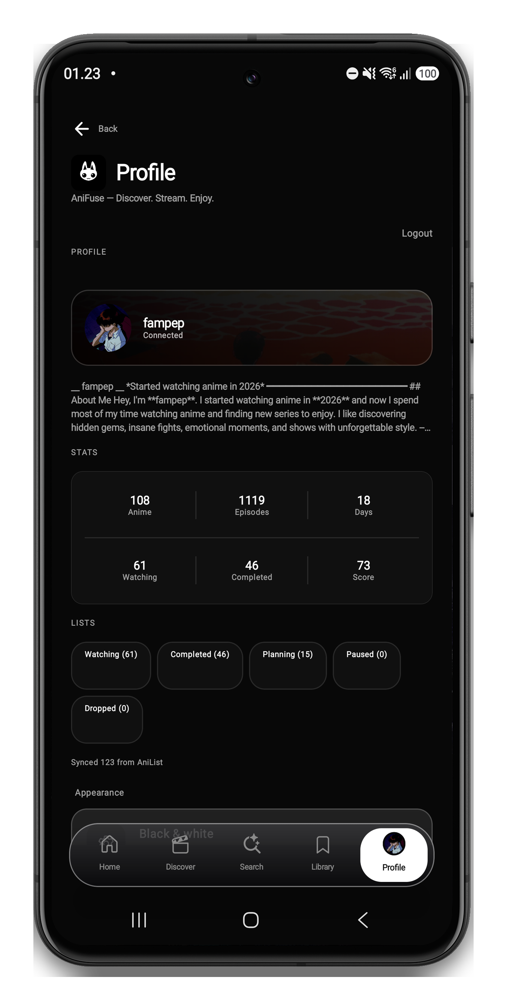

<div align="center">
  

  <h1>AniFuse</h1>

  <p><strong>Your AniList. On the phone. Streams from live sites.</strong><br>
  Monochrome glass chrome. Colour stays in the artwork. Progress stays with you.</p>

  <p>
    <a href="https://github.com/fampep/AniFuse-android/releases/latest"></a>
    <a href="https://github.com/fampep/AniFuse-android/releases"></a>
    <a href="https://github.com/fampep/AniFuse-android/releases"></a>
    <a href="https://github.com/fampep/AniFuse-android/blob/main/LICENSE"></a>
    
  </p>

  <p>
    <a href="https://github.com/fampep/AniFuse-android/releases/latest"></a>
    <a href="https://github.com/fampep/AniFuse-android/releases/download/dev/AniFuse_dev.apk"></a>
  </p>

  <p>
    <a href="https://ko-fi.com/E6C820K9H8"></a>
  </p>

  <p>
    <a href="https://t.me/Anikittymoe">Telegram</a>
    ·
    <a href="https://github.com/fampep/AniFuse-android/issues">Issues</a>
    ·
    <a href="CONTRIBUTING.md">Contributing</a>
  </p>
</div>

<p align="center">
  
  &nbsp;
  
  &nbsp;
  
</p>

<p align="center">
  
  &nbsp;
  
</p>

> [!WARNING]
> **Unofficial.** AniFuse is not affiliated with AniList, any studio, or any streaming site.
>
> **This project hosts no video.** A stream plays only when an extension returns a URL. The app does not control that site. The site may show ads or send you somewhere that is not safe.
>
> **You are responsible** for the laws where you are, and for the terms of every site an extension opens.
>
> **No warranty. Use at your own risk.** Install APKs only from the [releases of this repository](https://github.com/fampep/AniFuse-android/releases). A file from anywhere else is not this project.

---

## What it is

AniFuse is a **local-first Android client** (Kotlin, Jetpack Compose, Media3).

| | |
| --- | --- |
| Package | `site.anikitty.app` |
| Deep link | `anikitty://` (kept so existing installs update in place) |
| Account | AniList on device — there is no AniFuse account |
| Streams | Live site extensions on the phone (bundled + store). Optional self-hosted API: [fampep/anifuse](https://github.com/fampep/anifuse) |

Black-and-white chrome. Anime artwork carries the colour. The floating glass dock is always one thumb away from Home, Discover, Search, Library, and Profile.

---

## Install

**Android 8 or newer.** Open a release, download the APK, allow install from this source if Android asks.

| Channel | Get it | Notes |
| --- | --- | --- |
| **Stable** | [Latest stable](https://github.com/fampep/AniFuse-android/releases/latest) | Everyday build. Filename is `AniFuse_<version>.apk`. |
| **Dev** | [Rolling APK](https://github.com/fampep/AniFuse-android/releases/download/dev/AniFuse_dev.apk) or newest prerelease on [Releases](https://github.com/fampep/AniFuse-android/releases) | Latest push to `main`. Can break. |

Inside the app: **Profile → App** → Stable or Dev. A newer build on the channel you picked shows up there.

---

## Screens

Pixel 8 device frames of the current monochrome glass UI (night theme, public catalog). Capture notes: [`docs/screenshots/README.md`](docs/screenshots/README.md).

| Screen | What you get |
| --- | --- |
| **Home** | Spotlight hero, continue watching, shelves, floating glass dock |
| **Title** | Full-bleed art, glass actions, episode stills from live sites + AniZip |
| **Player** | Media3 — Source / Quality / Audio card, failover, PiP, Cast |
| **Library** | Week goal, AniList lists, continue row |
| **Profile** | AniList identity, stats, settings hub |

---

## Features

### Browse & library

- **Home** — cinematic picks, continue watching, latest sub/dub shelves
- **Discover** — genre, year, season, format, status, score
- **Search** — AniList search
- **Library** — watching / plan / completed, downloads, week goal
- **Profile** — AniList stats, look, player, extensions, builds

### Playback

- Sub and dub, auto next, skip intro/outro when timings exist
- Adaptive quality, instant source failover when a CDN dies
- Picture-in-Picture and Chromecast when a route is available
- Progress saved on the phone and synced to AniList when signed in

### Look

- Black & white chrome · floating glass dock · Fluent icon set
- Artwork and stills carry colour; AMOLED look available in settings

### Sources

Bundled live-site resolvers (Anikoto, AniGato, ani.pm / AniPm, AniNz, …) race with health-aware failover. Community extensions install from the in-app store or a manifest link and can be toggled one by one. The app plays URLs — it does not upload episodes.

---

## Releases

Names follow [uBlock Origin](https://github.com/gorhill/uBlock/releases). Tag and title are the version. No `v` prefix.

| Channel | Name | Example | When |
| --- | --- | --- | --- |
| Stable | `x.y.z` | `1.2.13` | Manual: Release workflow with **stable**, or a commit message containing `[stable]` |
| Dev / alpha | `x.y.zbN` | `1.2.13b0` | Every other push to `main`. Prerelease. `b` counts up from `0` |

After stable `1.2.12`, next dev builds are `1.2.13b0`, `1.2.13b1`, … Cutting stable publishes `1.2.13`, then `main` moves to `1.2.14b0`.

Older builds used `1.2.12-dev.28` and a `v` on the tag. Those still install. Each numbered release attaches `AniFuse_<version>.apk`, signed with the same key so it installs over previous builds. Version name and code live in [`VERSION`](VERSION).

The floating `dev` tag is only a moving download — not a version number.

---

## Extensions

| | |
| --- | --- |
| Author guide | [`extensions/GUIDE.md`](extensions/GUIDE.md) |
| Protocol | [`extensions/spec/PROTOCOL.md`](extensions/spec/PROTOCOL.md) |
| Store | [`fampep/anikitty-extensions`](https://github.com/fampep/anikitty-extensions) · [`store/index.json`](https://github.com/fampep/anikitty-extensions/blob/main/store/index.json) |
| Disclaimer | [`extensions/DISCLAIMER.md`](extensions/DISCLAIMER.md) |

A link in the store is not fampep running that server. Community extensions stay with their authors.

---

## Build

```bash
cd apps/android
./gradlew :app:assembleRelease
```

Release APK: `apps/android/app/build/outputs/apk/release/`.

Pull requests run unit tests, a debug APK, and lint. Pushes to `main` re-run tests and publish the release APK.

---

## License

Copyright 2026 fampep · [Apache License 2.0](LICENSE)

This product uses the TMDB API but is not endorsed or certified by TMDB.

Questions and bugs → [GitHub issues](https://github.com/fampep/AniFuse-android/issues). Chat → [Telegram](https://t.me/Anikittymoe). Support → [Ko-fi](https://ko-fi.com/E6C820K9H8).
